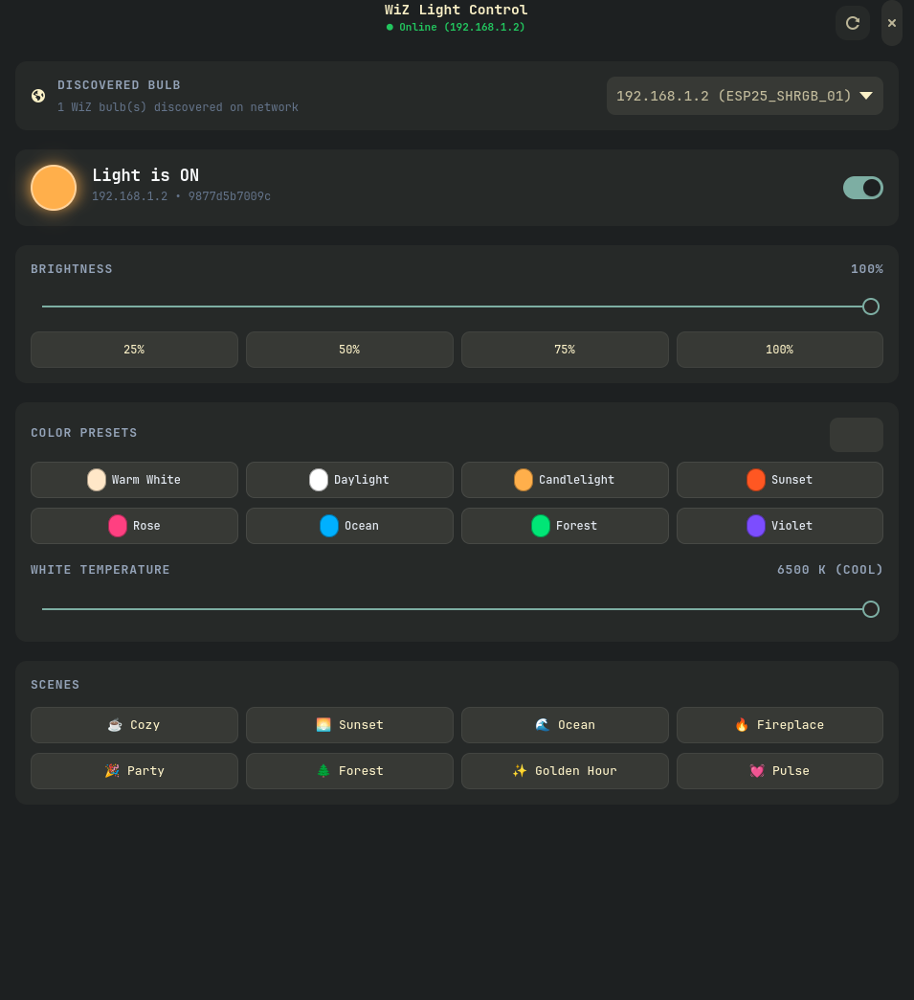

# WiZ Smart Light Control & Music Synchronizer

A lightweight, high-performance controller and music synchronizer for WiZ Connected smart lights. Includes a modern native GTK4 GUI written in Go, a standalone Windows application, real-time audio sync, and cross-platform command-line tools.



---

## Highlights

- ⚡ **Native GTK4 GUI (Go)**: Modern, clean, dark-themed control center built with GTK4 (`wiz-gtk`). Instant LAN discovery without local cache dependency.
- 🪟 **Standalone Windows Builds**: Pre-compiled, zero-dependency `.exe` binaries with the exact same GTK4 dark UI styling (`WiZ-Control.exe` GUI and `wiz-cli.exe`).
- 🎵 **Real-Time Music Synchronizer**: Syncs bulb color, brightness, and strobe effects with system or microphone audio using live FFT analysis (Beat Pulse, Energy Pulse, Spectrum, Hue Flow, and Disco modes).
- 🚀 **Blazing Fast CLI**: Fast Go & Python CLI tools to scan, inspect, toggle, dim, color-pick, and set scenes on your lights from any terminal or script.
- 📡 **Zero-Latency UDP Discovery**: Automatic subnet broadcast, `/proc/net/arp` inspection, and active sweep on port `38899`.
- 🎨 **Color & White Spectrum**: Full 24-bit RGB control, Kelvin color temperature slider (2200K–6500K), quick color chips, and 32 WiZ built-in scene presets.

---

## Downloads & Releases

Pre-compiled standalone binaries are available on the [Releases](https://github.com/whale2186/wiz-control/releases) page:

| Platform | Type | File | Description |
| :--- | :--- | :--- | :--- |
| **Windows x64** | GUI Application | `WiZ-Control-Windows-x64.zip` | Standalone portable `.exe` with identical GTK4 dark design, no dependencies required |
| **Windows x64** | Command-Line | `wiz-cli-Windows-x64.zip` | Lightweight standalone Go CLI executable (`wiz-cli.exe`) |
| **Linux x86_64** | GTK4 GUI | `wiz-gtk-Linux-x86_64.tar.gz` | Native GTK4 dark-theme desktop application |
| **Linux x86_64** | Command-Line | `wiz-cli-Linux-x86_64.tar.gz` | Standalone Go CLI tool (`wiz-cli`) |

---

## Quickstart

### 1. Modern GTK4 Interface (Linux)

Launch the native GTK4 Go app:
```bash
./wiz-gtk
```

To build from source:
```bash
go build -o wiz-gtk ./cmd/wiz-gtk
```

### 2. Standalone Windows GUI

Download `WiZ-Control-Windows-x64.zip` from Releases, unzip, and double-click `WiZ-Control.exe`.

### 3. Go CLI (Cross-Platform)

```bash
# Scan local network
wiz-cli scan

# Check status
wiz-cli status 192.168.1.2

# Turn on / off
wiz-cli on 192.168.1.2
wiz-cli off 192.168.1.2

# Adjust brightness (10% to 100%)
wiz-cli dim 192.168.1.2 75

# Set RGB color
wiz-cli color 192.168.1.2 255 120 40

# Set white temperature (2200K to 6500K)
wiz-cli temp 192.168.1.2 3200

# Activate built-in scene (1 to 32)
wiz-cli scene 192.168.1.2 1
```

---

## Music Synchronizer

The music synchronizer captures audio from your default recording device or system monitor loopback and dynamically modulates bulb brightness and hues to the beat.

```bash
# Energy Pulse mode
python wiz_cli.py music --ip 192.168.1.2 --mode energy --sensitivity 1.5

# Beat Detection mode
python wiz_cli.py music --ip 192.168.1.2 --mode beat --fps 25

# Spectrum Frequency Mapping (Bass=Red, Mid=Green, Treble=Blue)
python wiz_cli.py music --ip 192.168.1.2 --mode spectrum

# Ambient Hue Flow
python wiz_cli.py music --ip 192.168.1.2 --mode flow --base-brightness 20
```

### Music Modes:
- **`energy`**: Brightness pulses dynamically with audio volume/RMS.
- **`beat`**: Color flashes on transient drum and bass kicks.
- **`spectrum`**: Frequency band analysis mapping bass to warm red/orange, mids to green/yellow, and highs to blue/violet.
- **`flow`**: Smooth ambient hue wheel rotation modulated by audio activity.
- **`disco`**: Rapid random color jumps on sharp energy peaks.

---

## Python Desktop Suite

If you prefer the Python Tkinter interface with room grouping, logging, and color pickers:

```bash
# Set up virtual environment
python -m venv .venv
source .venv/bin/activate    # On Windows: .venv\Scripts\activate

# Install dependencies
pip install -r requirements.txt

# Run Python GUI
python wiz_gui.py
```

---

## Architecture & Protocols

- **Protocol**: WiZ local UDP JSON protocol on port `38899`.
- **Discovery**: Zero-configuration discovery using LAN broadcast (`255.255.255.255`, interface broadcast), active ARP neighbor probes, and subnet sweeps.
- **State Handling**: Thread-safe UDP communication with automatic debouncing (65ms) and single-flight queries to prevent packet dropping on ESP-based light modules.
- **Compatibility**: Compatible with all standard WiZ RGB, Tunable White, and Dimmable lights (ESP8266 / ESP32 firmware).

---

## License

MIT License. See [LICENSE](LICENSE) for details.
